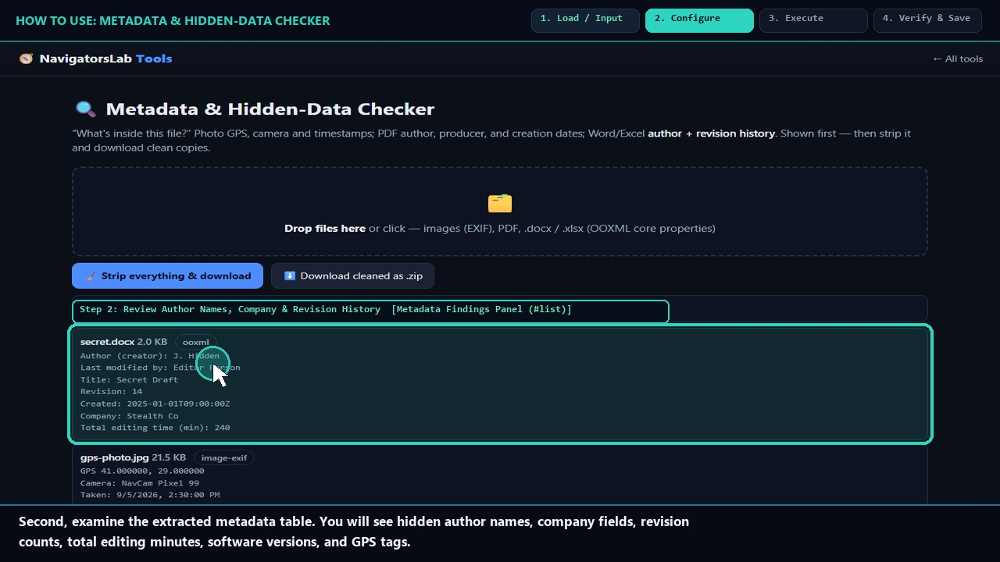
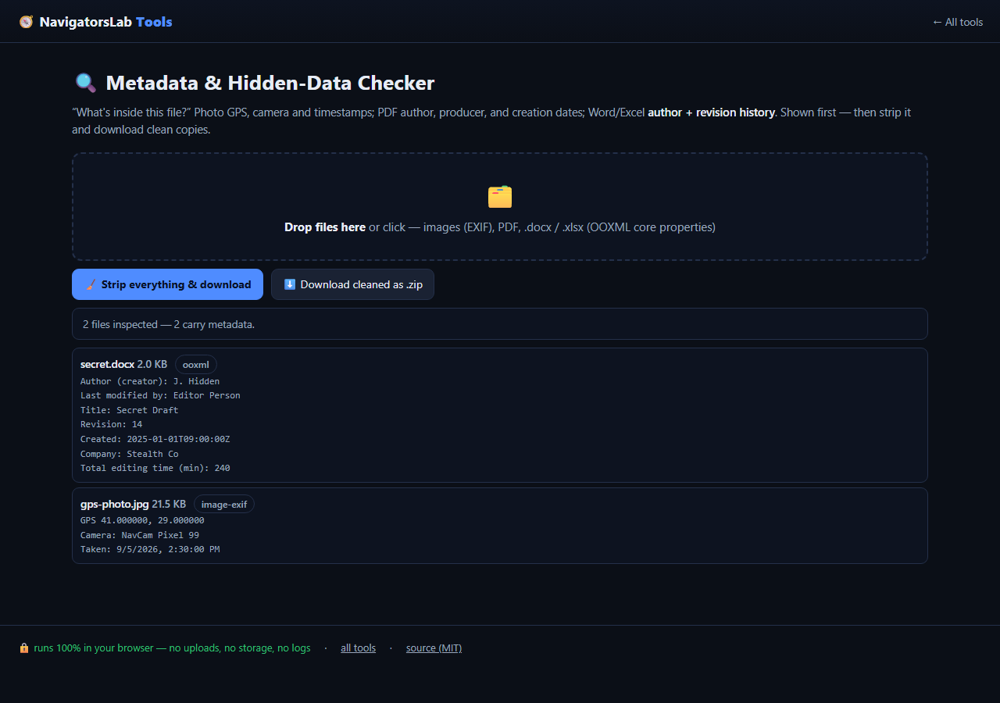

# 🔍 Metadata & Hidden-Data Checker

> See what's really inside a file — then strip it

     

<h4 align="center">
  &#9654; <a href="https://navigatorslab.com/tools/metadata.html">Open it on navigatorslab.com</a> &mdash; free, no sign-up, nothing uploaded<br>
  <a href="https://navigatorslab.com/Metadata-Checker">navigatorslab.com/Metadata-Checker</a> &middot; <a href="https://navigatorslab.com/tools/videos/metadata.mp4">🔊 Watch Narrated Step-by-Step Tutorial Video</a> &middot; <a href="https://navigatorslab.com/tools/videos/notebooklm-overview.mp4">Watch Full Suite Hands-On Video</a><br>
  This repo's Pages site runs the <em>actual tool</em>: <code>demo.html</code>
</h4>



Photo GPS, PDF author fields, Word revision history, company names, editing time. Shown first, stripped second.

## 📖 Complete Step-by-Step User Guide

### Step 1: Drop Documents or Images Into the Inspector (`Universal Dropzone (#dz)`)
- **How to do it:** Drag and drop any `.pdf`, `.docx`, `.xlsx`, `.pptx`, `.odt`, `.ods`, `.odp`, `.jpg`, `.png`, or `.webp` file onto the inspector dropzone (`#dz`).
- **Expected result:** The engine parses container dictionaries and ZIP XML streams locally.

### Step 2: Review Author Names, Company & Revision History (`Metadata Findings Panel (#list)`)
- **How to do it:** Review each file card in `#list`. The inspector surfaces PDF `/Info` and `/Metadata` XMP keys, Office `docProps/core.xml` and `app.xml` fields (Creator, LastModifiedBy, Company, Revision count, TotalTime), and image EXIF tags.
- **Expected result:** All hidden identity and revision fields are highlighted clearly on screen.

### Step 3: Click Clean & Download All (`Clean All Button (#stripAll)`)
- **How to do it:** Click **Clean & download all (`#stripAll`)** (or the per-file **Clean & download** button) to scrub `/Info` dictionaries, XMP packets, and OOXML/ODF `core.xml`/`app.xml` properties.
- **Expected result:** A sanitized copy of your PDF, Office document, or image is rebuilt in memory.

### Step 4: Re-Drop to Verify Zero Hidden Fields (`Cleaned Output Verification`)
- **How to do it:** Save the exported `.clean.pdf` or `.clean.docx` file and drop it back into `#dz` to confirm all identity and revision fields now read empty.
- **Expected result:** Document is safe to send to clients, opposing counsel, or public portals.

## 🎛️ UI Controls, Shortcuts & Parameters Reference

| Control / Shortcut | What It Does |
|---|---|
| `File Dropzone (`#dz`)` | Accepts PDF, DOCX, XLSX, PPTX, ODT, ODS, ODP, JPEG, PNG, and WebP files. |
| `Clean & download all (`#stripAll`)` | Rewrites metadata dictionaries across all loaded files and triggers local download. |
| `Per-File Field Table` | Displays exact key/value pairs found inside `/Info`, XMP, `docProps/core.xml`, and `docProps/app.xml`. |

## 💡 Pro Tips & Real-World Workflows

- 💡 Always run Word (`.docx`) and PDF proposals through Metadata Checker before sending to clients—Word records cumulative editing minutes (`TotalTime`) and previous authors by default.
- 💡 After cleaning metadata properties, remember to also check visible document body text for comments or tracked changes.
- 💡 Combine with `share-safe` CLI in CI pipelines if you publish PDFs automatically from a repository.

## 🧪 Concrete Example: Input → Engine → Output

| Stage | What Happens | Details |
|---|---|---|
| **1. Raw Input** | **Board-Proposal-v4.docx & Q3-Model.pdf** | Hidden OOXML & PDF Info: Author 'Jane Doe', Company 'Acme Corp', 14 revisions, 312 mins editing time, XMP stream |
| **2. On-Device Engine** | **Local ZIP central-directory & XML parser + pdf-lib Info/XMP inspector reveals every hidden field before stripping** | Runs 100% client-side in your browser tab under strict `CSP` (`connect-src 'none'`). |
| **3. Verified Output** | **Board-Proposal-v4.clean.docx** | Author, Company, Revision count, TotalTime & XMP metadata wiped; re-inspected in-browser with 0 leaks |

```text
dc:creator: REMOVED | cp:revision: REMOVED | TotalTime: 0 | Re-check: 0 hidden fields [OK]
```

- 🔊 **Narrated Step-by-Step Usage Tutorial Video (`41s`):** [`demo.mp4`](./demo.mp4) (also live at [`https://navigatorslab.com/tools/videos/metadata.mp4`](https://navigatorslab.com/tools/videos/metadata.mp4))
- 🎬 **Full Suite Hands-On Video Guide:** [`https://navigatorslab.com/tools/videos/notebooklm-overview.mp4`](https://navigatorslab.com/tools/videos/notebooklm-overview.mp4)

## ✅ What it does

- See what is really inside any file: EXIF / IPTC / XMP, embedded thumbnails, document history
- Deep PDF inspection: Info dictionary *and* XMP metadata, shown before anything is stripped
- OOXML (docx/xlsx/pptx) and ODF (odt): authors, revisions, editing time, custom properties, thumbnails
- Export a cleaned copy where the format allows — all parsed locally

## 🚀 Try it in 30 seconds

1. Drop any file: PDF, Word, Excel, image…
2. Read the hidden-data report, section by section
3. Export a cleaned copy where the format allows

## 📸 Live UI in action



## 🔒 Private by design

- **100% on-device** — files are processed in your browser and **never uploaded** to any server
- **No accounts, no tracking, no cookies, nothing retained** — open the page and work
- **Works offline** once loaded; fully mobile-friendly
- **Free & open source (MIT)** — use it at home, at work, anywhere

## 🤖 Built for humans *and* AI agents

- Deep-linkable via URL parameters — see the [Agent Mode guide](https://navigatorslab.com/tools/agents.html)
- Machine-readable catalog: [llms.txt](https://navigatorslab.com/tools/llms.txt) · [llms-full.txt](https://navigatorslab.com/tools/llms-full.txt)
- MCP endpoint: `POST https://navigatorslab.com/tools/mcp` (tool catalog + deterministic text tools — see the [main repo](https://github.com/Kayforkind/NavigatorsLab-Tools))
- No build step required to *use* any tool — just the URL

## 🛠 Under the hood

pdf-lib (PDF Info + XMP) plus zip central-directory parsing for OOXML/ODF

Third-party components are catalogued in [NOTICE](NOTICE); this repo is MIT-licensed ([LICENSE](LICENSE)).

## 🗂 The NavigatorsLab Tools suite

The full catalog — every tool in the hub with the same zero-upload promise, plus the lab's apps, CLIs and engines:

| Tool | What it does | |
|---|---|---|
| 🛡 Photo Privacy Kit | Strip GPS, camera model and timestamps before posting | [Open](https://navigatorslab.com/tools/exif.html) |
| 🔐 Password Breach Checker | Has this password been breached? — it never leaves your tab | [Open](https://navigatorslab.com/tools/breachcheck.html) |
| **🔍 Metadata & Hidden-Data Checker** | See what's really inside a file — then strip it | [Open](https://navigatorslab.com/tools/metadata.html) |
| 🗜 Image Shrinker | Hit “max 2 MB” portal limits without TinyPNG | [Open](https://navigatorslab.com/tools/shrink.html) |
| 📄 Scan & Screenshot Cleaner | Phone photos of documents → clean, straight PDFs | [Open](https://navigatorslab.com/tools/scan.html) |
| ✍ Local E-Sign Pad | Sign this lease tonight — not DocuSign | [Open](https://navigatorslab.com/tools/sign.html) |
| 🧾 Receipts → One PDF | Shoebox of receipt photos → one date-sorted PDF | [Open](https://navigatorslab.com/tools/receipts.html) |
| 🔢 Receipt OCR → CSV | Read totals off receipt photos, export for expenses | [Open](https://navigatorslab.com/tools/ocr.html) |
| 🔳 QR Studio | Generate QR codes and decode QR images — no site sees them | [Open](https://navigatorslab.com/tools/qr.html) |
| 🎧 Audio Trimmer | Cut voice notes and clips on a waveform | [Open](https://navigatorslab.com/tools/audio.html) |
| 🧮 Invoice / Quote Generator | One-person shops: hours in, clean PDF out | [Open](https://navigatorslab.com/tools/invoice.html) |
| 🗂 Batch Rename & Sort | IMG_5847.jpg → 2026-09-05-receipt-home-depot.jpg | [Open](https://navigatorslab.com/tools/rename.html) |
| 🖨 Print-Shop Prep | Exact sizes, bleed, DPI checks, print-ready PDF | [Open](https://navigatorslab.com/tools/printprep.html) |
| 📑 PDF Pages | Reorder, rotate, delete and extract PDF pages | [Open](https://navigatorslab.com/tools/pdfpages.html) |
| 🔬 Text Diff | Compare two texts with word-level highlights | [Open](https://navigatorslab.com/tools/textdiff.html) |
| 🎨 Reimagine | Redesign any HTML page from its own content | [Open](https://navigatorslab.com/reimagine/) |
| 📊 Text Stats | Words, reading time, readability, keyword density | [Open](https://navigatorslab.com/tools/textstats.html) |
| 📜 PDF Studio | Edit the text inside your PDF — private, free, open source | [Open](https://navigatorslab.com/pdf-studio/) |
| 🩺 Design Health | 18 deterministic design-quality checks for HTML — no LLM, no API key | [Open](https://github.com/Kayforkind/design-health-action) |
| 🔪 Skill Slice | Copy one Read-verified skill folder — a slice, not the pie | [Open](https://github.com/Kayforkind/skill-slice) |
| 🕵 liecatchers | Your agent said Done. Prove it — ten sensors, one RECEIPT.json | [Open](https://github.com/Kayforkind/liecatchers) |
| 📚 Book Guide MCP | Ship improvements with your books — agents cite, run playbooks, learn | [Open](https://github.com/Kayforkind/book-guide-mcp) |
| 📡 Data Insights | Founder intelligence — daily & weekly tech signal briefs | [Open](https://github.com/Kayforkind/data-insights) |
| 🪓 Iron Axe: Legacy | An original side-scrolling beat 'em up — Godot 4 | [Open](https://github.com/Kayforkind/iron-axe-legacy) |

---

<p align="center">
  <b>One hub, twenty-four projects:</b> <a href="https://navigatorslab.com/tools/">https://navigatorslab.com/tools</a><br>
  <b>Source &amp; the whole suite:</b> <a href="https://github.com/Kayforkind/NavigatorsLab-Tools">https://github.com/Kayforkind/NavigatorsLab-Tools</a>
</p>
